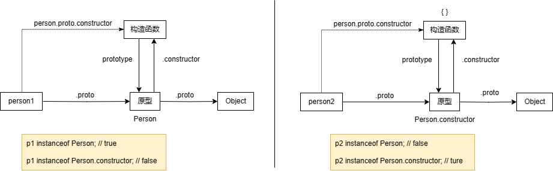

- 声明：`class name { }`；实例：`new name( )`

```javascript
// 类声明
class Person {}
// 类表达式
const Animal = class AnimalClass {};

// 接收类的变量名称可以改变，之后可以通过 Aniaml.name 属性获取类名称字符串；但不能单独使用类名称字符串访问类
Animal.name // AnimalClass
AnimalClass // undefined
```

类表达式`Animal`，在它们求值之前不能被引用，且不能被提升。

- 作用域： **块级作用域** 限制

## 类的构成

### 类方法

类方法等同于对象属性，其键可以是 字符串、符号、或是计算后的值

```javascript
class Person { // 类名首字母大写；类中的方法， 不需要function；方法之间不需要, 隔开
    // 构造方法
	constructor(uname){
        // 实例成员
		this.name = uname; // 自动添加了属性
	}
    // 实例方法
	sing(song) {
		console.log(this.name + song);
	}
    // 静态方法：每个类上只有一个，this引用自身；适合用作实例工程
    static shareWithSub() {}
    // 获取函数
    get myName {}
    // 设置函数
    set myName(newName) {}
}
```

### 成员数据

把方法定义在类构造函数、类块中，但不能在<u>类块中</u>给原型添加原始值、对象作为成员数据。给原型定义成员数据：

```javascript
Person.prototype.greeting = 'my name is'
Person.name = 'Jack'
console.log(`${Person.prototype.greeting} ${this.name}`)
```

### 迭代器 & 生成器

```javascript
class Person {
    *createNameIterator(){ // 原型上定义迭代器
		yield 'Jack';
		yield 'Mack';
		yield 'Anry';
    }
    static *createTimeIterator(){ // 类上定义迭代器
		yield '220101';
		yield '220102';
		yield '220103';
    }
}
const timeIterator = Person.createTimeIterator
timeIterator.next().value //220101
timeIterator.next().value //220102

let p = new Person();
const nameIterator = p.createNameIterator()
nameIterator.next().value //Jack
nameIterator.next().value //Mack
```

添加一个默认迭代器，把类实例变成可迭代对象

```javascript
class Person {
    constructor(){
        this.name = ['Jack','Mack','Anry']
    }
	*[Symbol.iterator]() { // 返回迭代器，不直接执行内部指令
        yield *this.name.entries();
    }
    [Symbol.iterator]() { // 返回元素地址，键值对
        yield *this.name.entries();
    }
}
```

```javascript
class Star {
    constructor( name, age ){
        this.btn = document.querySelector('button');
        this.btn.onclick = this.sing; 	// 当点击时，调用sing函数，
        this.btn.onclick = this.sing(); // 立即执行sing函数，undefined
       	/**
        个人理解：this.sing 传入了函数所在的地址，点击时查找到函数再调用；this指向调用者
                this.sing() 是函数调用语句，返回的结果赋值给按钮；this指向构造者
        */
    }
}
```

## 实例化

**类必须使用new实例化对象。**解释器在使用`new`操作符创建类时，需要调用`constructor`关键字定义的函数。不定义构造函数，相当于使用空函数。[使用`new`操作符时，执行四个步骤](#newOperate)。

类实例化时传入的参数，会作为构造函数的参数。**默认情况下，返回构造函数创建的对象**；如果修改默认返回值，而是其他对象，这个结果将不会被`instanceOf`检测出跟类有任何关系。

```javascript
class Person{
    constructor(){
        return {}
    }
}
let p1 = new Person(); // {}
```

类的构造函数，除了必须使用`new`操作符调用，在类实例化完成后，就成为了一个普通的实例方法。

普通构造函数不使用`new`调用，以全局的`this`（通常是`window`）作为内部对象

```javascript
let p1 = new Person(); // {}
p1 instanceof Person  // true

let p2 = new Person.constructor(); // 使用构造函数引用构造一个新实例
p2 instanceof Person //true

p1 == p2 // false
```

**类中定义的`constructor()`不会被当作构造函数**




**类的本质是一个特殊的函数。类**标识符有`prototype`属性，这个原型中的`constructor`属性指向类自身。 **类中定义的`constructor()`不会被当作构造函数**

（实例只保留指向原型的指针`[[prototype]]`，没有指向构造函数的指针）

```javascript
typeof Person // function
// Person 被认为是构造函数
Person === Person.prototype.constructor // true
```

## 用法

### 作为参数

```javascript
let classList = [
    class {
        constructor(id){
            this.id = id;
            console.log(`instance ${this.id}`)
        }
    }
]
function createInstance(classDefinition, id){
    return new classDefinition(id)
}
let foo = createInstance(classList[0],1); // 批量生成类 foo = classList {id: 1}
```

### 立即实例化

```javascript
new class Foo {
 	constructor(id){
        this.id = id;
        console.log(`instance ${this.id}`)
    }
}(1)
```

## 继承

```javascript
class Father {
    constructor (x, y) { // 1.父类生成实例时，父类的x、y被赋值
        this.x = x;
        this.y = y;
    }
    sum() {
    	console.log(this.x + this.y); // 2.这里this指向父类的x、y
    }
}
class Son extends Father {
    constructor (x, y) {
        super(x, y); // 4. 调用父类构造方法，必须在使用 this 之前
    }
}
let son = new Son(1, 2); // 3.生成子类，父类构造函数已调用，x、y 已赋值

son.sum(); // 3
```

- `extends` 也可以在类表达式中使用：`const Son = class extends Father {}`
- `this` 谁调用指向谁
- super关键字：调用父类的函数（构造函数、静态函数）
  - 只能在派生类的构造函数、静态函数中调用
    - 在构造函数中使用`super()`，表示直接调用父类构造函数`super.constructor()`，需要手动传入
    - 静态函数中使用`super`，可以调用继承类的静态方法。
  - 会返回父类的`this`，所以【! super必须在子类this之前】
- call方法： 在子构造函数中，使用`Father.call(this)`

派生类中显示定义了构造函数，要么🔖返回调用`super`返回父类 ，要么🏷️返回一个对象

```javascript
class Son extends Father {
    constructor(){
        super();
    }
}
class Son extends Father {
    constructor(){
        return {};
    }
}
```

## 抽象基类

可以给其他类继承，但本身不能实例化；使用`new.target`识别当前实例化的类型，从而决定要不要对其进行实例化

```javascript
class Vehicle{
    constructor() {
		console.log(new.target);
        // 识别当前实例化的类型
        if(new.target === Vehicle) throw new Error("Vehicle can't be directly instantiated")
        // ..

        // 必须实现某个方法
        if(!this.foo) throw new Error("Inheriting class must define foo{}");
    }
}

new class Bus extends Vehicle {
    foo() {}
}
new class Bus extends Vehicle {} // Error：Inheriting class must define foo{}
new class Vehicle {} // Error：Vehicle can't be directly instantiated
```

## `species`访问器

返回实例类型，其被构造函数用以创建派生对象。`getter`默认返回`this`，未部署`setter`属性；默认情况下，返回原始实例类型一致。

如果需要覆盖这个行为，可以在子类的构造函数内声明为静态方法，或者用 `Object.defineProperty` 等方法添加或修改此属性。

```javascript
class MyArray extends Array {
  // 覆盖 species 到父级的 Array 构造函数上
  static get [Symbol.species]() {
    return Array;
  }
}

const myArray = new MyArray();
myArray instanceof MyArray; // true
myArray instanceof Array;   // true
```

## 类混入

把不同类行为集中到一个类中。

:one: `Object.assign()`：将多个对象属性混入

:two: `extend`关键字后接表达式

```javascript
class Vehice {}
function getParentClass () {
    console.log('get superClass1')
    return Vehice;
}
class Bus extends getParentClass() {} // Bus extends Vehice

// 多重继承: 接受一个超类做为参数，将混入类定义为这个参数的子类
let doorMixin = (SuperClass) => class extends SuperClass{
    door() { console.log("add car door") }
}
let glassMixin = (SuperClass) => class extends SuperClass{
    glass() { console.log("add car glass") }
}

//
class Bus extends doorMixin(glassMixin(Vehice)){}
let bus = new Bus();

// 借助辅助函数，展开嵌套调用
function mixin(BaseClass, ...Mixins){ // Aarry.reduce 累加遍历；accumulator 累加器
	return Mixins.reduce((accumulator,current) => {
        return current(accumulator)
    }, BaseClass) // BaseClass 初始值
}
class Bus extends mixin(Vehice,doorMixin,glassMixin){}
let bus = new Bus();
```

## 三个注意点

1. this的指向问题：
   1. constructor 里的`this`指向`创建的实例对象`
   2. 类中方法的`this`指向`调用的实例对象`
2. 类没有变量提示：必须先声明、后使用
3. 使用类中共同属性、方法，一定要加this