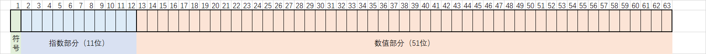

## 特殊数字

number的数字进制

1. 二进制：0b

2. 八进制：0

3. 十六进制：0x

number的最大值最小值

1. 最大值： Number.MAX_VALUE

2. 最小值：Number.MIN_VALUE（5e-324，最小正数）；

3. 最负有限值为 -Number.MAX_VALUE

无穷大 无穷小

1. 无穷大：Infinity — 大于最大值
2. 无穷小：-Infinity — 小于最小值
3. NaN，代表非数值
   1. 本应该返回数值的操作数，未返回操作数
   2. `NaN != NaN` 不等于任何数

## 判断

1. 数字的类型 `Number.isInteger()`：是否为整数

2. 是否为NaN：

   1. Number.isNaN();
      1. true：仅当值本身是 NaN；`'blue'` 等不能转为数值的字符串返回 false（先做 ToNumber 的是全局 `isNaN`）
      2. 不是NaN， false
   2. Object.is(,NaN)

3. 判断是否是 **安全整数**：

   ​	在 **Number.MIN_SAFE_INTEGER** （$-2^{53}+1$）到 **Number.MAX_SAFE_INTEGER** （$2^{53}-1$） 范围内二进制值可以表示一个整数值。超出这个范围，即使尝试保存为整数，也会保存成一个错误的完全不同的数值。

   ​	判断是否在安全范围内，可以使用 **`Number.isSafeInteger()`**，返回 true

   **[0.1 + 0.2 ≠ 0.3 问题](#numberSafePro)**

## 转化

1. `parseInt()` 和 `parseFloat()`，专门为字符串转数字

   1. 忽略字符串的空格，直到找到第一个非空格字符
   2. 空字符串`""`，没有数字字符串（如`'blue'`）， 转化结果为NaN
   3. 可将数字开头的字符串删去后边非字符串的部分，仅保留数字
   4. 对于Int，小数点不是有效数字字符
   5. 对于Float，第二个小数点不是有效数字字符

2. `Number()`可以转任何类型为数字，要求字符串需为数字字符串

   |           |                     |                       |
   | --------- | ------------------- | --------------------- |
   | Boolean   | true=1              | false=0               |
   | Number    | Number原值          |                       |
   | null      | 0                   |                       |
   | undefined | NaN                 |                       |
   | String    | 空字符串            | 0                     |
   |           | 只包含数值          | 十进制数              |
   |           | 包含有效浮点数      | 忽略前置0，转为浮点数 |
   |           | 包含`0x`的数值      | 十六进制数            |
   |           | 包含`0b`的数值      | 二进制数              |
   |           | 除此之外            | NaN                   |
   | Object    | :one: ValueOf() 转  | 若为NaN               |
   |           | :two: toString() 转 |                       |

3. `toString` 接受一个表示基数的参数，返回相应基数形式的数值字符串

4. `toFixed()` `toExponential()` `toPrecision()` 调整小数位精确表示数值：

   - `toFixed()`： 指定小数点位，不足用0填充；超过位数，四舍五入。
   - `toExponential()`：科学计数法，指定小数的位数。`(99).toExponential(1) = "9.9e+1"`
   - `toPrecision()`：根据数值和精度决定调用`toFixed()`还是 `toExponential()`

## Number对象 & Number值

​	<a href="/javascript/基本类型/2022/08/03/2.2.基本数据类型-Boolean.html#boolean对象--boolean值">存在着和 Boolean 同样的问题。</a>

## 0.1+0.2 ≠ 0.3

​	原因： 采取 **IEEE-754 64位双精度** 浮点数存储， Javascript、 Java 、python等语言都存在这个问题

​	一个浮点数占64个bit，由符号位（0为正，1为负）、指数部分（确定小数点在第几位）、数值部分

- 指数部分，使用 <u>移码表示法</u>

  - 11bit 指数部分 e 为无符号整数（0~2047，全 1 的 2047 保留给 Inf/NaN）；$2^0$ 的隐藏位属尾数，规范数下一定为 1（不存储）
  - 小数位置 $p = e -1023$ （1023 是指数偏置值，不是指数部分 bit 都为 1）
  - $p=1075-1023=52$时， 所有数值部分都被用来表示整数；52bit 全为1时，是能够表示的最大数值 9007199254740991

    - $max +1 = 9007199254740992$ : 小数点向右移动一位 p=53，隐藏位（第12bit）=1，整数部分（53bit）为0 —— 第53bit 不存在只能为0
      - $9007199254740992+1$ ：第53bit 无法修改为1，无法加2
      - $9007199254740992+2$ ：第52bit = 1， 53bit = 0（无法改变）
      - $9007199254740992+3$ ：第53bit 无法修改为1，无法加4
      - …… 以2为间隔相加
    - 小数点位为53，第45bit & 第54bit = 0 无法改变，只能以4为间隔相加
    - 之后的数值都无法完整表示，任何计算都会出错
  - 小数点位越过隐藏位（第11bit），所有数值部分都被用来表示小数；

    - 隐藏位固定值为1时（规范数），表示的数一直都是 $2^{-1}$ 幂次，值可能非常小，但一直有值
  - 指数部分的极端情况：
    - 符号位1、0  + 指数部分都为 `0` + 隐藏位为0 + 数据部分都为0 = ±0 —— 非规范数
    - 符号位1、0  + 指数部分都为 `1`  + + 数据部分都为0 = ±infinity
    - 符号位1、0  + 指数部分都为 `1`  + + 数据部分存在1 = NaN（typeof NaN = ”number“，<u>存在1的关系</u> 可以有多种NaN）

- 数字部分：小数位置将数值部分分为 整数和小数

  - 小数值 $x = 2^{-1} + 2^{-2} + \cdots + 2^{-n}$
    - 并非所有小数都是可以为 $ 2^{-n}$ 直接表示
    - 如 $0.1 \approx 2^{-4} + 2^{-5} + 2^{-5} + \cdots + 2^{-47}$， 51bit 只得到一个无限近似于 0.1 的值，已经存在误差
    - 用 $2^{-n}$ 相加得到小数， 当 $p=1074 - 1023 = 51$，只留给小数值 1bit 时，只能表示 `0.5`
  - 整数部分：

- 数字 ±0：除符号位，其他bit = 0 ，包括隐藏位，所以是非规范数
