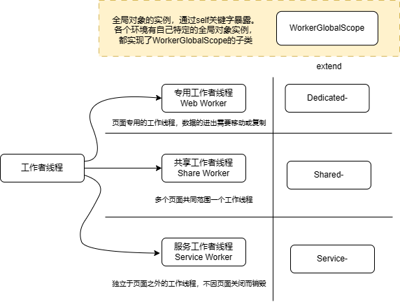

允许把主线程的工作转移到独立的实体，而不改变现有的单线程模式。浏览器主线程负责与处理用户事件和页面绘制等。

JavaScript环境实际是运行在托管操作系统的虚拟环境。每个页面都有自己的环境，内存、事件循环、DOM等等，不会影响到其他页面。所有页面环境都是并行处理的。

使用工作者线程，可以在原始页面环境之外，在分配一个完全独立的二级子环境，与主线程不能直接通信只能使用 **消息** 完成，**不能与依赖单线程交互的API（如DOM）互操作**，但可以**与父环境并行执行**。工作者线程相对较重，通常占用较大内存，不建议大量使用；调度之间存在性能损耗，所以应该谨慎使用线程，给常驻的、启动成本高的、计算量较大的工作分配。

🎈	以实际线程实现的，对应着底层的线程。

🎈	环境内的指令是可以并行执行的

🎈	可以共享某些内存，但不完全共享全部内存。可以使用`sharedArrayBuffer`在多个环境间共享内容 —— 使用`Atomics`接口实现并发控制，其他数据进出线程需要移动或者复制。

🎈	工作者线程不一定在同一个进程里，共享工作者线程和服务工作者线程就可能使用独立的进程。



**存在限制：**

🚫	**工作者线程**（顶级工作者线程和子工作者线程）**的脚本文件只能从父页面相同的源加载。**可以加载、执行其他非同源的脚本（`importScripts()`）。

🚫	Worker 线程和主线程不在同一个上下文环境，它们不能直接通信，必须通过消息完成。

🚫	Worker 线程无法读取本地文件，即不能打开本机的文件系统（`file://`）。

🚫 	无法读取、操作主线程所在网页的 DOM 对象、`window`对象等

**子工作者线程**，确保并行计算的投入的收益 > 多个子线程计算成本；子工作者线程的脚本路径根据父工作者线程解析。

## **本地文件初始化工作者线程**

工作者线程需要基于脚本文件创建，但不意味着该脚本必须是远程资源。可以利用`Blob`对象的URL在行内创建。 **可以更快速初始化工作者线程，没有网络延迟。**

Blob 对象，二进制类型的大文件，是不可变、原始数据的类文本对象；可以以文本、二进制格式读取，或转为`readable Stream`。

- `new Blob(array,{option})`：
  - array，可迭代对象，Array、DataView、Blob、字符串或他们的混合，将被放入Blob中
  - option，指定`type`（指定数据的MIME类型）和`endings`（包含结束符`/n`字符串将如何被写入）两个属性的对象
    - `MIME`（多用途互联网邮件扩展类型 `Multipurpose Internet Mail Extensions`)，如`text/html` `image/png` `text/plain` `text/javascript`
    - `endings:transparent` 默认值，保存不变
    - `endings:native` 更改为更适合宿主系统的换行符。
- `URL.createObjectURL(object)` —— `URL.revokeObjectURL(objectURL)`
  - 传入 File / Blob / Medioa 对象 用以创建 URL
  - 使用`URL.createObjectURL(object)`创建对象URL，代表对象存在引用，会影响内存垃圾回收，应该在合适时机使用`URL.revokeObjectURL(objectURL)` 释放URL对象
  - Web Worker中可以用，在Service Worker中不可以用，可能导致内存泄漏。

```javascript
// 函数后序列化传入，在父上下文中定义，在子上下文中执行
function Fibonacci(n) {
    return n<1 ? 0 : n<2 ? 1 : Fibonacci(n-1) + Fibonacci(n-2)
}

// 字符串
const workerString = `
	self.onmessage = ({data}) => console.log(data);
	self.postMessage((${ Fibonacci.toString() })(9))
`
const workerBlob = new Blob([workerString],{type: 'text/javascript'})
const workerBlobURL = URL.createObjectURL(workerBlob);
const worker = new Worker(workerBlobURL)
worker.onmessage = ({data}) => console.log(data) // 34 接收worker回传数据
worker.postMessage('hi,just say something?'); // hi,just say something? 向worker发生数据

// 缩写：
const worker = new Worker(URL.createObjectURL(new Blob([workerString])));
```

### 在工作者线程中动态执行脚本

使用`importScripts()` 方法编程方式，<u>不一定按顺序</u>加载、<u>按顺序同步</u>执行任意脚本，可以接收<u>任意数量的参数</u>

- 无论是什么类型文件，都会当成JavaScript解析，所以需要是有效的 JavaScript MIME 类型，如`text/javascript`
- 在工作者线程内部可以请求任何来源的脚本（没有`CORS`限制）
- 加载成功后，每个脚本中的全局上下文都能够在 Worker 线程中使用 —— 共享作用域
- 如果脚本无法加载，将会抛出错误，并且之后的代码也无法执行了

```javascript
// main.js
const worker = new Worker('./worker.js',{name:'foo'});

// worker.js
importScripts('./scriptA.js','./scriptB.js');
const workerToken = 'worker.js'
console.log(`in worker.js,, name is ${ self.name }, workerToken is ${ workerToken }`)

// scriptA.js
console.log(`in scriptA.js, name is ${ self.name }, workerToken is ${ workerToken }`)
// scriptB.js
console.log(`in scriptB.js, name is ${ self.name }, workerToken is ${ workerToken }`)
```

#### 处理工作者线程错误

抛出错误的工作者线程，可以不打断父线程的执行。父线程的`try/catch`捕获不到工作者线程抛出的错误，不过错误依然会冒泡到工作者线程的全局上下文，因此可以在Worker对象上设置 **错误事件监听器** 才可以访问到。

```javascript
// main.js 
const worker = new Worker('./woker.js')
worker.onerror = console.log; // isTrusted: true, message: 'Uncaught Error: errormessage',....

// woker.js
throw Error('errormessage')
```