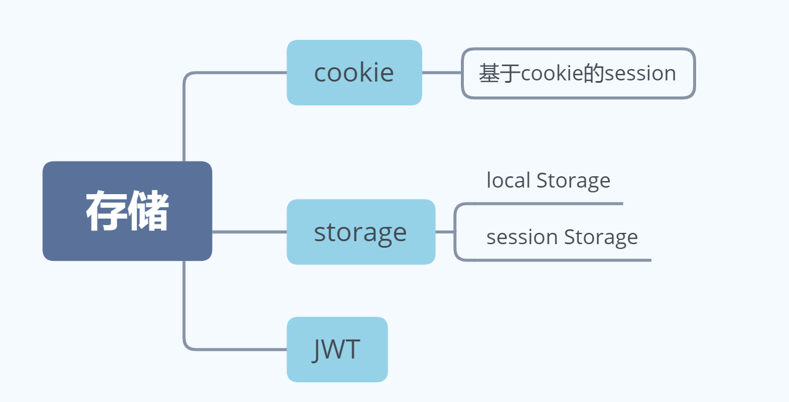
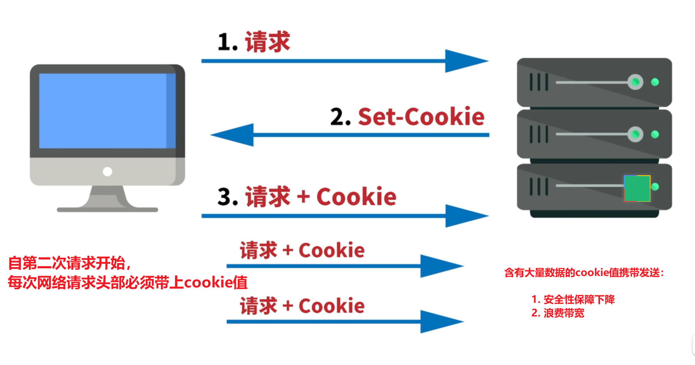
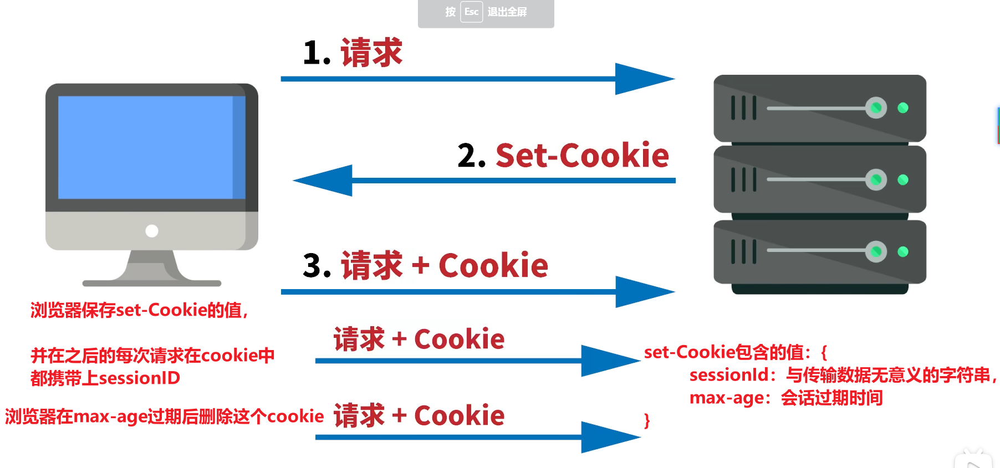
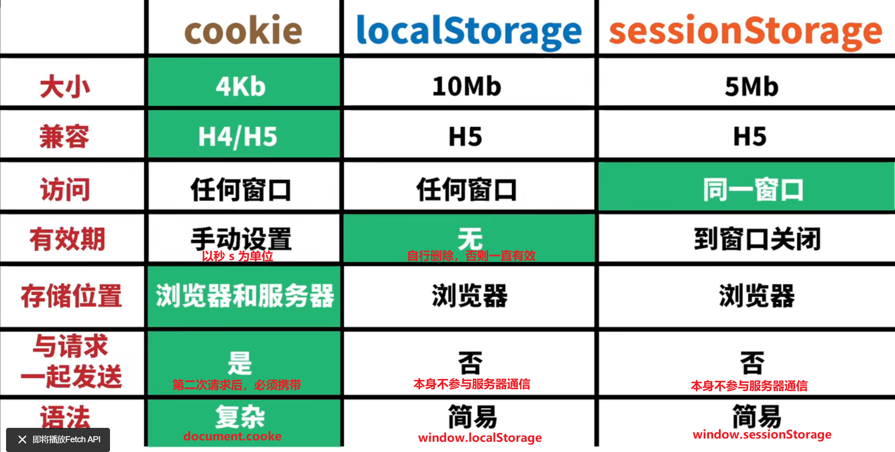
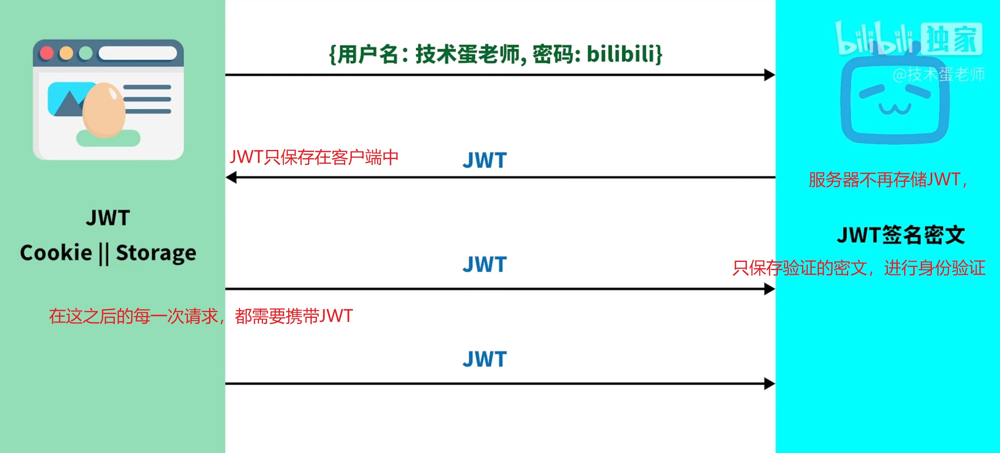
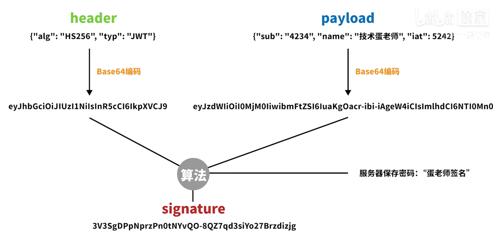

## 存储



因为 <u>HTTP 是面向文本、无状态的协议（HTTP/1.1 默认持久连接）</u>，所以需要每次请求头部带上 cookie，使服务器可以给不同用户匹配不同的内容

### HTTP cookie

1. 基本概念:

   1. 由服务器端生成，发送给客户端浏览器
   2. 浏览器将这些数据保存至**客户端的**指定目录下的文本文件中
      1. 这样在下一次访问相同的网站时可以直接使用该cookie数据。
      2. 浏览器可以查询到cookie值，不安全
   3. **“键-值”对(key-value pairs)** 的形式保存的 key 和 value 都可以自定义
   4. 常见用于判断用户是否已登陆网站，或者保存购物车中等待付款的商品信息等。

2. 用于处理单个事务，因为存在以下问题:

   1. cookie的存储数据量小(4kb/个,只能保存50个)
   2. cookie请求限制：每次浏览器与服务器进行请求时，cookie必须存放在请求头部传输到服务器端。

3. 使用场景

   

#### cookie编码

```html
 <form action="">
     <label for="">用户名</label> <input type="username"> <br>
     <label for="">密码</label> <input type="password"> <br>
     <input type="checkbox" id="remeberMe"> <label for="remeberMe">记住我</label> <br>
     <input type="submit" value="登录">
</form>
<script>
    const username = document.querySelector('input[type="username"]');
    const password = document.querySelector('input[type="password"]');
    const checkbox = document.querySelector('input[type="checkbox"]');
    const submit = document.querySelector('input[type="submit"]');
    // cookie之间用 ; 分割，cookie内部用 = 分割
    let array = document.cookie.split(';').filter(Boolean).map(cookie => cookie.trim().split('='));
    let cookie = {};
    for (let i = 0; i < array.length; i++) {
        let name = array[i][0].trim();  // 第一个值为 键
        let value = array[i][1]; // 第二个值为 值
        cookie[name] = value === undefined ? '' : decodeURIComponent(value); // 输入框的值经过编码，这里需要解码
    }
    // 若cookie内部存有值，加载页面完成后自动加载进去
    if (document.cookie) {
        username.value = cookie.yourname;
        password.value = cookie.youpsw;
        checkbox.checked = true;
    }
    // 提交按钮添加监听器
    submit.addEventListener('click', e => {
        if (checkbox.checked && username.value != '') {
            let key = 'yourname';
            let value = encodeURIComponent(username.value); // 用户输入不可控，可能出现乱码，需要编码
            let passTime = 2 * 24 * 60 * 60; // 设置保质期时间，单位是 s
            document.cookie = `${key}=${value}; max-age=${passTime}`;
        }
        if(checkbox.checked && password.value != '') {
            let key = 'youpsw';
            let value = encodeURIComponent(password.value);
            let passTime = 2 * 24 * 60 * 60;
            document.cookie = `${key}=${value}; max-age=${passTime}`;
        }
        e.preventDefault(); //取消一个目标元素的默认行为
    });
</script>
```

#### 基于cookie的Session



**sessionID生成、保存在服务器中，由服务器主导；使用cookie作为数据载体存放在浏览器中**

优点：

👍 传递的session值，并不包含敏感信息（敏感信息存放到服务器中），相对安全，且值较小

👍 sessionID 内部有指定的签名，非法修改过后服务器将无法识别而不提供服务

👍 浏览器退出登录后，服务器内的session将会被删除；再拿着这个sessionId请求会话将无效

缺点：

👎 入侵者拿到SessionID后，可以合法时间内，伪装宿主的登录状态发送请求

👎 特点时间大量用户访问服务器，服务器可能要面对存储大量SessionID的压力；

👎 多台服务器需要分配用户时，每台服务器都需要通用的SessionID，才能避免用户多次输入数据登录，占用空间；使用数据库，若数据库出现问题，会影响服务器获取SessionID

—— 解决办法：使用 JWT



### Web存储

1. “键-值”对(key-value pairs)的形式存储在**Web客户端**(不常与服务器通信)
2. Web存储更适用于存储大量数据(5~10M)，
3. 发生请求时不会带上Web存储的内容。

浏览器支持的情况

```html
<script>
	if('localStorage' in window && 'sessionStorage' in window){
	//浏览器支持Web存储中的localStorage/sessionStorage
    // 值不为空
	}else{
	//浏览器不支持Web存储中的localStorage/sessionStorage
	}
</script>
```

#### Storage接口

Storage接口实现数据的添加、修改、查询或删除。

1. `StorageName.length`：该只读属性返回值为整数形式，表示当前存储对象中“键-值”对的总数量
2. `key(n)`：用于返回数据中第n个值的名称。如果n大于所有键值对的总数，则返回null值。
3. `getItem(key)`：用于返回指定键名称的值，如果该名称不存在，则返回null值。
4. `setItem(key，value)`：用于设置一条自定义的"键值"对数据，如果该数据原先不存在，则会在存储对象的键值对列表中新增该数据；如果该数据的键名称原先存在，则看数据值是否有变化，如有变化则更新成最新值，否则不做任何操作。
5. `removeItem(key)`：用于删除存储对象中指定key名称的数据，如果没有则不做任何操作。
6. `clear()`：用于清空存储对象中的键值对列表，如果原先就无任何数据则不做任何操作。

#### localStorage 和 sessionStorage

##### 共同点

1. 优势
   1. Storage拓展了cookie的4K限制
   2. 将第一次请求的数据直接存储到本地
2. 局限
   1. 浏览器的大小不统一，并且在IE8以上的IE版本才支持
   2. 值类型限定为string类型，在JSON对象类型需要一些转换
   3. 浏览器的隐私模式下面是不可读取的
   4. 本质上是对字符串的读取，**同步加载机制**，如果存储内容多的话会消耗内存空间，会导致页面变卡
   5. localStorage不能被爬虫抓取到

##### 不同点

- localStorage属于永久性存储
- sessionStorage属于当会话结束的时候，键值对会被清空

#### Storage 代码

```css
 span{
     display:inline-block;
     background-color: aqua;
     margin-left: 5px;
     width: 20px;
     height: 20px;
}
```

```html
<input type="text">
<button>搜索</button>
<ul class="history"></ul>
```

```javascript
const text = document.querySelector('input[type="text"]');
const btn = document.querySelector('button');
const history = document.querySelector('.history');

if(localStorage.length > 0){ // 加载完成时，加载local Session中的值
    for( let i = 0; i<localStorage.length; i++) {
        // 给history添加li
        let key = localStorage.key(i);
        let li = document.createElement('li'); 
        let liText = document.createTextNode(localStorage.getItem(key)); //创建一个 节点内容
        li.appendChild(liText);
        history.appendChild(li);
        // 给li添加删除按钮
        let close = document.createElement('span');
        li.append(close);
        close.addEventListener('click', () => {
            localStorage.removeItem(key);
            li.parentNode.removeChild(li); // li的父节点，删除这个li
        })
    }
}
btn.addEventListener('click', () =>{
    if( text.value){ // 输入框内容不为空
        let key = new Date().valueOf(); // 时间对象，new的时间点，valueOf() 取其原始值，作为键值（不重复）
        let value = text.value;
        localStorage.setItem(key, value); // 添加localstrorage的方式
        text.value = ''; // 初始化输入框
        // 给history添加li
        let li = document.createElement('li');
        let liText = document.createTextNode(localStorage.getItem(key)); // 添加节点内容
        li.appendChild(liText);
        history.appendChild(li);
        // 给li添加删除按钮
        let close = document.createElement('span');
        li.appendChild(close);
        close.addEventListener('click', ()=>{
            localStorage.removeItem(key);
            li.parentNode.removeChild(li);
        })
    }
})
```

#### 属性和操作

##### setItem 存储数据

- 以"健值对"的方式存放数据
- `setItem('key', 'value');`可简写为`localStorage['key']= 'value';`或者`localStorage.key='value';`
- 单双引号配合使用，表示话中有话

##### getItem 读取指定数据

- 获取指定了键名称的数据值
- `getItem('name')`可简写为`localStorage.name(已知具体的键名称时方)`
- 变量不可简写

#### removeItem 数据遍历

- `Storage.removeItem('name')`
- 彻底删除，包括数据的键名称和对应的值
- 如果提供的键名称无法匹配到已存储的数据信息，则本次不进行删除操作。

#### clear 删除和清空

`Storage.clear();`该方法不带任何参数，直接调用clear()可以清空整个localStorage或sessionStorage对象中的所有数据

### JWT

JSON Web Token

#### 使用场景

**token是生成于服务器，但保存在浏览器中，由客户端主导一切（可以存放在cookie、session中）**



#### 组成

```text
JTW -- header.payload.signatur
		算法.  数据.   签名
```

- header：声明签名算法
- payload： 存放有效信息数据
- signature： 签证

header 和 payload 只是 base64url 编码的明文（并非加密），修改任何一段都会导致签名校验失败；`alg:none` 可能被绕过，安全性取决于服务端校验


