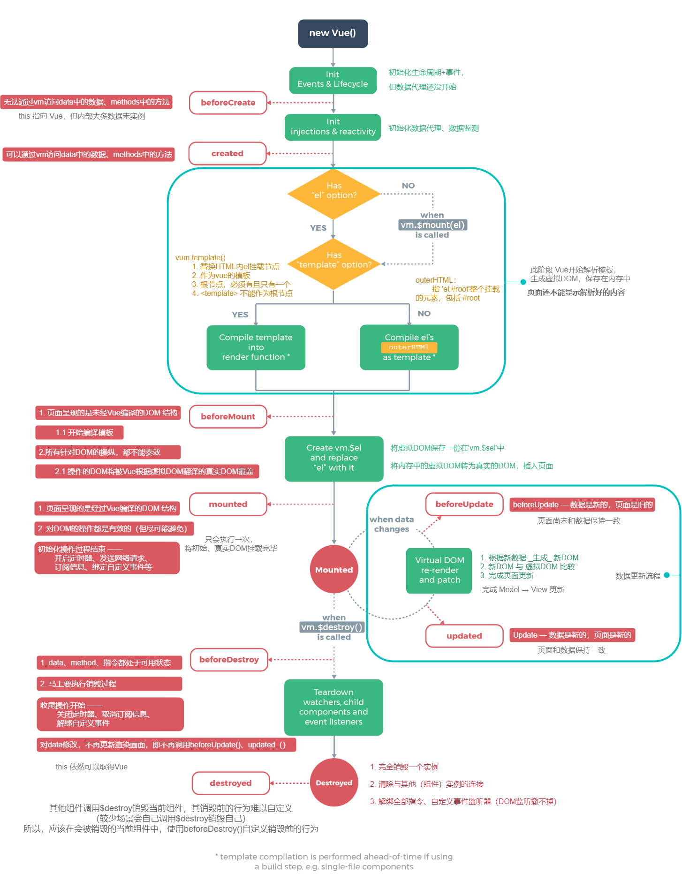

## Vue生命周期

- created:html加载完成之前，执行。执行顺序:父组件-子组件
- mounted:html加载完成后执行。执行顺序:子组件-父组件
- methods:事件方法执行
  * 可用`this`调用其他方法
- watch:去监听一个值的变化，然后执行相对应的函数
- computed:computed是计算属性，也就是依赖其它的属性计算所得出最后的值

### 销毁 & 事件

​	**当调用`this.$destroyed`后，原生的事件回调仍然可以被触发**，如`@cilck()`等；

​	子组件以及组件自定义的事件 & 页面响应式变化就会被销毁而无法触发